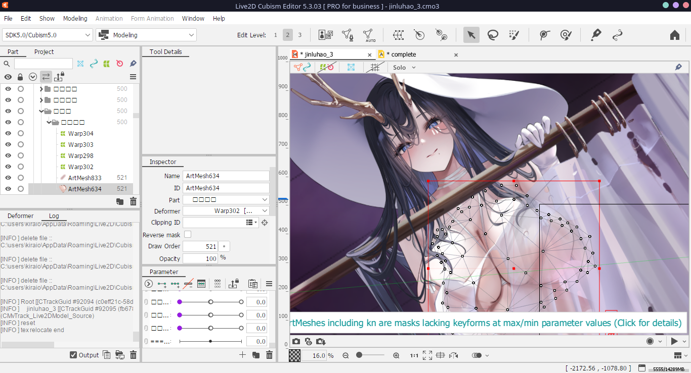
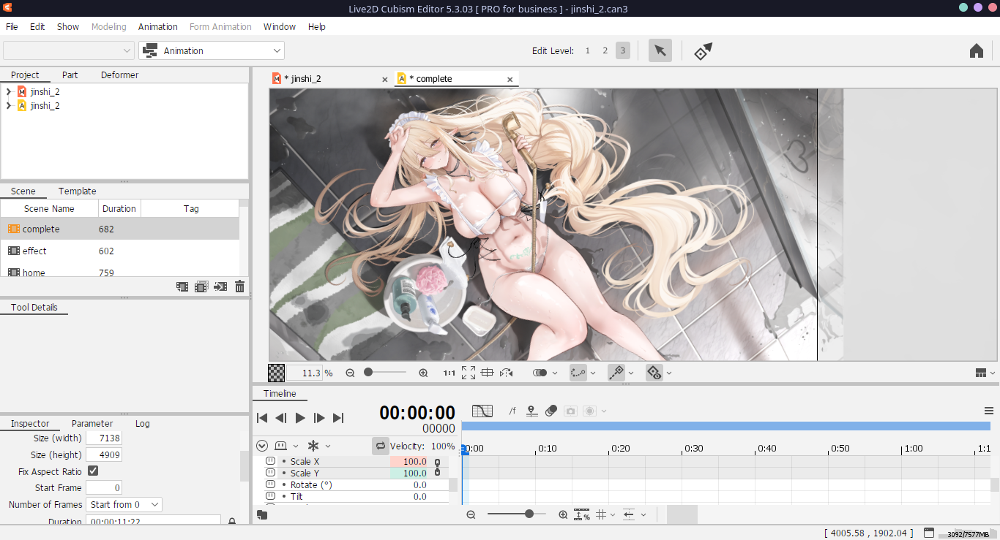

<h1 align="center">Azur Lane Live2D</h1>

This repository contains Live2D assets of [Azur Lane](https://azurlane.yo-star.com/), not only the ripped runtime data files (`.moc3`, `.motion3.json`, etc.) but also a near-source project files (`.cmo3`, `.can3`) that you can edit on Cubism Editor. Some model may have slightly off the canvas center, but all is good.

See the ship skin list and it's corresponding asset name in here https://docs.google.com/spreadsheets/d/1GYQTiz7DQzj2fnACG2VbjDei9xSYsn6rIEZ5valueWE/edit?usp=sharing. If there's missing skin(s), create an issue and I'll take a look.

## How to Download

The Live2D `.png`, `.moc3`, `.cmo3`, `.can3` files are stored as LFS file, you need some steps to download it.

### GitHub Method

Click every files you want to download and click the ⬇️ download button on right top.

### Git LFS Method

```
git lfs pull <remote_name> // get entire repository
git lfs pull --include="path/to/file1,path/to/file2" // get multiple files
git lfs pull --recursive --include="path/to/directory" // get a folder and it's subdirectory
```




## Disclaimer

This repository is not partnered nor endorsed by Shanghai Manjuu, Xiamen Yongshi, Yostar or it's partners. All rights reserved to the original creators.
